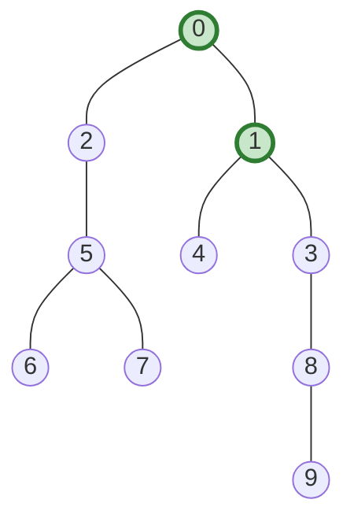
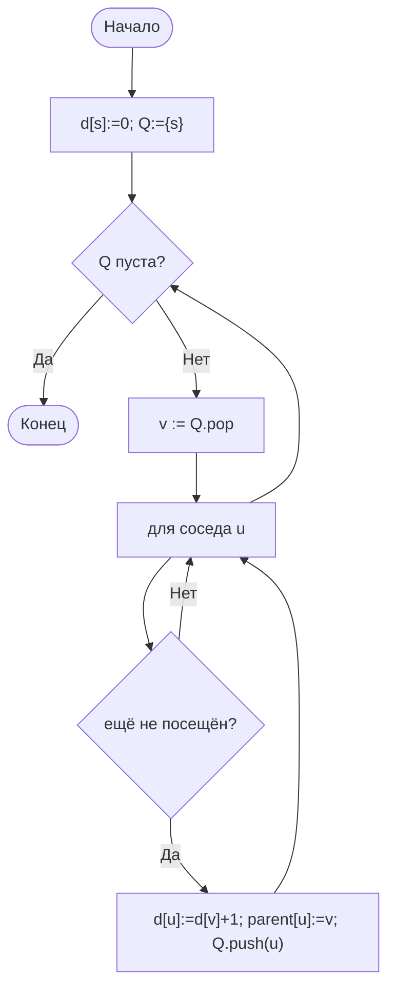

# Лабораторная работа № 9

**Способы представления графов и алгоритмы обхода в ширину и в глубину**

| | |
|---|---|
| **Дисциплина** | Основы алгоритмизации и программирования |
| **Направление** | 38.03.05 «Бизнес-информатика» |
| **Курс** | 2 |
| **Группа** | БИ 2-1 |
| **Выполнила** | Осипова Анна Алексеевна |
| **Вариант** | 17 |
| **Язык реализации** | Python 3.10+ |
| **Год** | 2026 |

---

## 1. Цель работы

Изучить представления графов (матрица и списки смежности), реализовать BFS и DFS, найти **центр дерева** и сравнить представления по времени и памяти на деревьях.

---

## 2. Задание варианта 17

| Параметр | Значение |
|---|---|
| Тип графа | **Д** — дерево (m = n−1, связный, без циклов) |
| Ориентированность | Неориентированный |
| Размеры n | 1000; 5000; 10 000 |
| Задача варианта | **Центр дерева** |
| Доп. задание | **И3** — визуализация малого графа и дерева обхода |

**Центр дерева** — вершина (или две) с минимальным эксцентриситетом. Алгоритм: два BFS → концы диаметра → середина диаметрального пути.

---

## 3. Теоретическая часть

### 3.1. Представления

| | Матрица смежности | Списки смежности |
|---|---|---|
| Память | Θ(n²) | Θ(n + m) |
| Проверка ребра | Θ(1) | Θ(deg v) |
| Перебор соседей | Θ(n) | Θ(deg v) |
| Полный обход | Θ(n²) | Θ(n + m) |

Для **дерева** m = n−1 → списки Θ(n), матрица Θ(n²) — разрыв огромен.

### 3.2. BFS и DFS

- **BFS** (очередь): кратчайшие пути по числу рёбер; порядок по уровням.
- **DFS** (стек, итеративный): удобен для циклов, компонент; на цепочке рекурсия опасна.

### 3.3. Центр дерева

1. BFS из любой вершины → самая дальняя **a**.
2. BFS из **a** → самая дальняя **b**, путь a…b = диаметр.
3. Середина пути — центр (1 вершина при чётном диаметре, 2 — при нечётном).

---

## 4. Тестовый граф (И3)



- BFS от 0: 0, 1, 2, 3, 4, 5, 8, 6, 7, 9
- DFS от 0: 0, 1, 3, 8, 9, 4, 2, 5, 6, 7
- Диаметр = 7, путь 9–8–3–1–0–2–5–6, **центр = {0, 1}**

---

## 5. Блок-схема BFS



---

## 6. Листинг (фрагменты)

```python
class ListGraph:
    def __init__(self, n):
        self.n = n
        self.adj = [[] for _ in range(n)]
    def add_edge(self, u, v):
        self.adj[u].append(v); self.adj[v].append(u)
    def neighbors(self, v):
        return self.adj[v]

def bfs(graph, start):
    dist = [-1] * graph.n
    parent = [-1] * graph.n
    dist[start] = 0
    q = deque([start])
    order = []
    while q:
        v = q.popleft()
        order.append(v)
        for u in graph.neighbors(v):
            if dist[u] == -1:
                dist[u] = dist[v] + 1
                parent[u] = v
                q.append(u)
    return order, dist, parent

def tree_center(graph):
    _, dist0, _ = bfs(graph, 0)
    a = max(range(graph.n), key=lambda v: dist0[v])
    _, dist_a, parent = bfs(graph, a)
    b = max(range(graph.n), key=lambda v: dist_a[v])
    # путь a→b по parent, середина = центр
    ...
```

---

## 7. Результаты

### 7.1. Время BFS и память на деревьях

| n | Матрица, с | Списки, с | Матрица, МБ | Списки, МБ | Центр | Диаметр |
|---:|---:|---:|---:|---:|---|---:|
| 1000 | 0,021 | 0,0003 | 7,7 | 0,13 | [0, 1] | 27 |
| 5000 | 0,603 | 0,0017 | 191 | 0,71 | [8, 16] | 39 |
| 10 000 | 3,895 | 0,0050 | 764 | 1,44 | [3, 8] | 37 |

На дереве списки быстрее в **~100–800 раз** и легче в **~50–500 раз**.

### 7.2. Центр дерева

Для каждого n найден центр (1–2 вершины) и диаметр за два–три BFS — Θ(n) на списках.

---

## 8. Выводы

1. Для деревьев (разреженных графов) **списки смежности** однозначно предпочтительнее матрицы по времени и памяти.
2. Матрица на n=10 000 занимает ~764 МБ против ~1,4 МБ у списков.
3. Центр дерева находится за O(n) двумя BFS по концам диаметра.
4. BFS даёт кратчайшие пути по числу рёбер; DFS — порядок «вглубь».
5. Итеративный DFS безопаснее рекурсивного на «глубоких» графах.

---

## 9. Контрольные вопросы

1. Граф G=(V,E); ориентированный — рёбра-дуги.
2. Разреженный m=O(n); плотный m=Θ(n²). Пример: оргструктура — дерево/разреженный.
3. Матрица Θ(n²)/Θ(n) на соседей; списки Θ(n+m)/Θ(deg).
4. Матрица — при плотном графе и частых проверках ребра.
5. BFS: очередь; посещение по уровням.
6. BFS обрабатывает вершины в порядке неубывания расстояния.
7. Путь восстанавливается по массиву parent.
8. Цикл в орграфе: ребро к «серой» (в стеке) вершине.
9. Рекурсия — переполнение стека; решение — явный стек.
10. Компоненты: повторный BFS/DFS из непосещённых; Θ(n+m).

---

## 10. Литература

1. Кормен Т. и др. Алгоритмы: построение и анализ. — Гл. 22.
2. Седжвик Р., Уэйн К. Алгоритмы на Java. — Гл. 4.
3. Скиена С. Алгоритмы. Руководство по разработке. — Гл. 7.
4. networkx.org

---

*Лабораторная работа № 9 • Осипова Анна Алексеевна • Вариант 17 • 2026*
